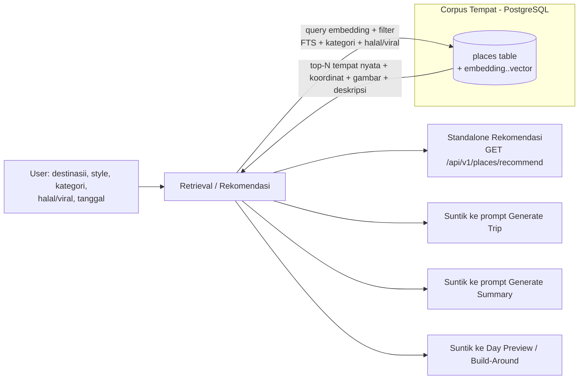
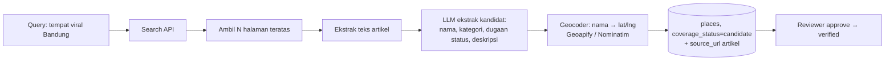

# Planning — Fitur Rekomendasi Destinasi Berbasis RAG

> **Tanggal:** 2026-08-24
> **Status:** Rancangan / menunggu keputusan
> **Dokumen terkait:** `PRD_RAG_REKOMENDASI.md`, `TRD_RAG_REKOMENDASI.md`
> **Ringkasan:** Menambahkan katalog tempat (corpus) + pengambilan relevan (retrieval) untuk
> 1) rekomendasi tempat saat membuat trip, dan
> 2) menyuntik tempat nyata (bukan halusinasi) ke prompt AI generate & summary.
> Tujuan awal contoh: tempat halal di suatu daerah, tempat viral. Tujuan bisa diperluas.

---

## 1. Latar belakang & kenapa ini penting

Dari eksplorasi kode, ditemukan pernyataan kunci di `backend/internal/autogen/usecase.go`:

> "coordinates (lat/lng) are intentionally NOT resolved here. The LLM is not
> trusted for coordinates (they are stripped during validation); instead the
> frontend resolves each location name to real coordinates via the Google Places API"

Artinya arsitektur saat ini **secara sadar tidak mempercayai pengetahuan tempat dari LLM** karena LLM sering berhalusinasi (nama tempat fiktif, kota/negara keliru). Alur sekarang:

```
User prompt → LLM (mengarang nama tempat) → validasi (strip koordinat)
   → frontend resolve via Google Places → baru koordinat nyata
```

Masalah:
- Nama tempat dari LLM tidak selalu nyata → resolve gagal / salah kota.
- Tidak ada "kebenaran" katalog tempat yang bisa diandalkan.
- Tidak ada kanalisasi rekomendasi (halal, viral, hidden gem) saat pengguna baru mau memilih destinasi.

**RAG (Retrieval-Augmented Generation) menjawab ini:** kita punya corpus tempat terkurasi (dengan koordinat, gambar, tag halal/viral, kategori), lalu *mengambil* tempat yang relevan dan *menyuntikkan sebagai fakta* ke prompt LLM — sehingga LLM memakai tempat nyata, bukan mengarang.

---

## 2. Konsep RAG yang diusulkan



Prinsip: **retrieval menghasilkan fakta terkurasi → dimasukkan ke prompt sebagai konteks → LLM hanya merangkai/merencanakan memakai fakta itu**. Ini memutar logika: LLM bukan lagi sumber kebenaran tempat, melainkan perencana yang memakai katalog.

---

## 3. Komponen arsitektur baru

### 3.1 Domain backend baru
```
backend/internal/
├── places/          # SUMBER KEBENARAN tempat (curated corpus)
│   ├── model.go
│   ├── repository.go
│   ├── repository_pg.go
│   ├── usecase.go   # pakai hybrid retrieval & rekomendasi
│   └── handler.go   # GET /api/v1/places/recommend, SEARCH, CRUD admin/seeding
├── embeddings/      # (Phase 2) pkg untuk vektor
```

### 3.2 Package lintas backend
```
backend/pkg/
├── embed/           # (Phase 2) klien embedding (OpenAI-compatible /embedding)
│   └── client.go
```

### 3.3 Infrastruktur
- **PostgreSQL 17** (Fase 0) + **pgvector** (Phase 2, TERPISAH) — penyimpanan embedding & similarity search. Infra pgvector:
  - **Dev (`docker-compose.yml`):** memakai `postgres:17-alpine` yang **tidak menyertakan pgvector** → ganti ke `pgvector/pgvector:pg17` saat Phase 2.
  - **Prod:** `docker-compose.prod.yml` **tanpa service postgres** (pakai Postgres terkelola eksternal = Neon). Neon sudah mendukung pgvector → cukup `CREATE EXTENSION IF NOT EXISTS vector;` sekali; pastikan provider mengizinkan ekstensi.
  - Ekstensi & kolom `vector` dimasukkan **hanya** di migrasi `022`, bukan `021`.
- **Redis** — cache hasil rekomendasi untuk query populer (kota+kategori+halal), seperti pola quota/expense yang sudah memakai Redis.

### 3.4 Integrasi (lihat file `backend/internal/integration/`)
Ikuti pola yang sudah ada (`TripContextProvider`, `autogen_creator.go`): package `integration` boleh mengimpor semua domain untuk merakit data. Tambahkan adapter baru untuk menyuntik tempat-relevan ke autogen & summary.

---

## 4. Data model tempat (corpus)

Tabel utama, disesuaikan dengan pola `internal/domain/repository_pg.go` + JSONB yang sudah dipakai:

| kolom | tipe | contoh / keterangan |
|---|---|---|
| `id` | UUID | PK |
| `name` | text | "Masjid Raya Bandung" |
| `city` | text | "Bandung" |
| `country_code` | text | "ID" |
| `area` | text | opsional, area/kecamatan |
| `lat` / `lng` | double precision | koordinat nyata (sumber terpercaya) |
| `category` | text | enum: kuliner, wisata_alam, budaya, belanja, akomodasi, ibadah, **lainnya** (default) |
| `tags` | text[] | {"halal","viral","hidden_gem","instagramable","kekinian"} |
| `halal_status` | text | `yes` / `no` / `halal_friendly` / `unknown` |
| `is_viral` | boolean | tren / viral |
| `description` | text | 1–2 kalimat (terkurasi / dari LLM lalu diverifikasi) |
| `image_url` | text | opsional |
| `source_url` | text | tautan sumber / Google Maps place |
| `google_place_id` | text | untuk pencocokan ke Places |
| `rating` / `price_level` | float / text | opsional, waktu-sensitif |
| `opening_hours` | jsonb | opsional |
| `embedding` | vector(dimensi mengikuti provider) | (Phase 2, di migrasi 022) |
| `coverage_status` | text | `verified` / `unverified` / `candidate` / `auto` |

Index:
- `idx_places_embedding ON places USING hnsw (embedding vector_cosine_ops)` (Phase 2, di 022)
- `GIN (tags)` + `GIN (to_tsvector('simple', name‖' '‖city‖' '‖coalesce(description,'')))`
- Index biasa: `(city, category)`, `(halal_status)`, `(is_viral)`.

---

## 5. Strategi retrieval (hibrida)

### Phase 1 (tanpa embedding — sudah berfungsi sebagai RAG dasar)
Untuk corpus terkurasi ukuran sedang (ribuan baris), retrieval berbasis teks + filter sudah kuat & murah, **tanpa perlu layanan embedding eksternal**:

```
skor = bobot( FTS(name/city/description/category/tags) )
     + bonus kategori & halal & is_viral & style
filter: city / area / country, halal_status, is_viral, style, budget-tier
urutan: skor turun → limit N
```

- Memakai PostgreSQL `tsvector` + GIN. Deterministik, offline, bebas biaya API.
- Cukup untuk rekomendasi destinasi & suntikan ke prompt.

### Phase 2 (embedding + pgvector — RAG "semantik" penuh)
- `pkg/embed` klien ke supplier embedding (tersedia via OpenRouter; atau OpenAI). Mendapatkan vektor untuk query & untuk setiap baris corpus saat ingestion.
- Simpan `embedding vector` di tabel, pakai operator `<=>` (cosine) dengan HNSW index.
- Gabung skor semantik + FTS (hybrid), rerank. Tangkap pertanyaan longgar: "tempat makan enak deket masjid" padahal kata-katanya tidak match.
- **Biaya embedding**: hanya saat ingestion & saat query (bisa dicache di Redis).

### Penggabungan (Phase 2)
`score = α · cosine_sim + β · bm25/fts` (dengan Bobot α,β bisa disetel). Mengambil top-N lalu hard-filter sesuai constraint user.

---

## 6. Integrasi ke fitur yang ada

### 6.1 Rekomendasi standalone (baru, nilai langsung)
- `GET /api/v1/places/recommend?city=&area=&category=&halal=&viral=&style=&limit=`
- Dipakai di wizard pembuatan trip: saat user ketik "Bandung", tampilkan kartu "Rekomendasi tempat" (gambar, koordinat, tag halal/viral). User bisa pilih → langsung jadi aktivitas.
- Juga endpoint pencarian: `GET /api/v1/places/search?q=&city=`.

### 6.2 Generate Trip (`autogen.GenerateDraft`)
- Panggil retrieval dengan `Destination` + `TravelStyle` dari `GenerateInput`.
- **Pola injeksi (preseden kode):** `BuildPrompt` adalah fungsi murni `func BuildPrompt(in GenerateInput) (system, user string)` — adapter **bukan** dipanggil dari `BuildPrompt`. Ikuti pola `DayContextProvider` + `WithDayContextProvider()` yang sudah ada di `autogen.Usecase`: tambah `PlaceContextProvider` yang di-inject, dipanggil di `GenerateDraft` **sebelum** `BuildPrompt`.
- Suntik `top-N` tempat nyata ke **system prompt** sebagai blok **"REKOMENDASI TEMPAT NYATA"**: **nama saja** + kategori + halal + deskripsi singkat (**tanpa koordinat** ke LLM).
- Ubah instruksi prompt: "Gunakan tempat dari daftar ini sebisa mungkin; JANGAN mengarang; jika perlu tambahan, pakai nama generik."
- **Koordinat dipasang SETELAH `GenerateDraft` kembali (di luar autogen):** layer `integration` mencocokkan `location_name` aktivitas dengan corpus → isi `ActivityDraft.Lat/Lng` + `LocationVerification="verified"`. Autogen tetap men-strip koordinat LLM (anti-halusinasi tidak berubah).
- Frontend resolver (`resolveDraftLocations.ts`) harus **skip** aktivitas yang `LocationVerification=="verified"` (sudah berkoordinat).

### 6.3 Generate Summary (`summary`)
- Retrieval ringan (misal berdasarkan destinasi/kota pada `TripContext.Destination`, atau kategori populer trip) untuk memperkaya "Tips lokal" / "rekomendasi".
- Prioritas lebih rendah daripada generate trip.

### 6.4 Build-Around / Day Preview (`autogen.GenerateDayPreview`)
- Retrieval tempat **dekat koordinat hari itu** (radius km) → suntik sebagai kandidat. Sangat cocok dengan `DayContext` yang sudah ada.

---

## 7. Sumber data corpus (cara mengisi tempat)

| Sumber | Kelebihan | Catatan / lisensi |
|---|---|---|
| **Paste link Google Maps** *(sumber utama, paling cepat)* | Ekstrak koordinat otomatis dari URL tanpa API; 1 link/baris bisa batch | Subcommand `link` → parse `@lat,lng` & `place_id` |
| **Kurasi manual** *(sumber utama)* | Tidak butuh kuota API; status halal/viral ditentukan sendiri; fokus "beberapa tempat penting" | Ambil koordinat via klik-kanan; tulis ke `seed/places/<kota>.yaml` |
| **AI-assisted exploration (LLM suggest)** | Mempercepat dari "halaman kosong" ke kandidat | AI TANPA koordinat (anti-halusinasi); menulis `coverage_status=candidate`; operator verifikasi |
| **Google Places API** *(sekunder / opsional)* | Data lengkap (coords, foto, rating), sudah dipakai di frontend | Ditunda sampai API pulih; perlu `google_place_id` utk dedup; patuhi atribusi/syarat |
| **Open Data (mis. Wikidata/OSM Overpass)** | Gratis, coords akurat, atribut halal/viral bisa ditambah manual | Perlu pipeline kueri + atribusi map |
| **UGC / "Save Place" user** | Corpus tumbuh organik, relevan | Terhubung ide `SavedPlace` di `docs/NAVISHA_SHEET_IMPROVEMENTS.md` |

**Rekomendasi:** mulai dengan **paste link / kurasi manual** per kota (mulai dari Bandung; tiap kota campuran kuliner halal, wisata, tempat viral, masjid), impor via CLI. Karena Google API sedang bermasalah, jalur manual memungkinkan kita langsung mulai tanpa key. **AI (`suggest`) dipakai untuk mempercepat eksplorasi kandidat** — bukan untuk menentukan koordinat/status final. Tambahkan enrichment (API) & UGC di fase lanjut. Label `coverage_status` agar tidak mencampur fakta vs kandidat.

---

## 8. Alternatif & rekomendasi lain

### A. Sistem rekomendasi berbasis aturan/statis (tanpa vektor)
- Simpan struktur tempat + filter. "Rekomendasi" cukup query berbasis tag.
- **Pro:** paling murah, deterministik, cocok untuk MVP.
- **Kontra:** kurang "semantik", pertanyaan longgar tidak tertangkap. Tapi untuk MVP destinasi halal/viral justru **cukup**.
- **Keputusan:** ini adalah Phase 1 dari usulan di atas — jalankan dulu, naik ke vektor bila perlu.

### B. RAG eksternal (vendor managed-like / service RAG terpisah)
- Server Go menambahkan sidecar/klien RAG (mis. dukungan pgvector di provider cloud, atau API embedding eksternal sebagai satu-satunya jalan).
- Hanya bila ingin menghindari kelola vektor sendiri. Mahal & tambah poin kegagalan; tidak direkomendasikan sekarang.

### C. Perbaiki LLM tanpa katalog (prompt/grounding ke Google Maps)
- Alih-alih corpus, minta LLM menghasilkan tempat lalu resolve ke Google — **persis keadaan sekarang**, tidak menyelesaikan halusinasi. **Tidak direkomendasikan.**

### D. Pendekatan "recommendation without AI" untuk UX
- Sebelum ada corpus, tampilkan saran berbasis **kategori statis per kota**. Ini bisa jadi pelengkap sementara, bukan pengganti RAG. (Catatan: pola ini *bukan* meniru `localtips.go` yang isinya daftar flat tips umum Indonesia — bukan per-kota/per-kategori.)

**Rekomendasi akhir:** jalur **Phase 1 (curated corpus + retrieval hibrida FTS/filter)** terlebih dahulu — sudah "RAG", murah, backend-sentris (cocok skill Anda), nilai langsung ke wizard trip. Lanjut **Phase 2 (pgvector + embedding)** begitu corpus & kebutuhan semantik tumbuh.

---

## 9. Milestone & estimasi effort

### Fase 0 — Tooling data (dikerjakan DULU — keputusan 2026-08-24)
- Migrasi tabel `places` + domain `internal/places` (model/repo).
- `cmd/place-seed`: subcommand `import` (seed YAML, **jalur utama tanpa key**), `link` (paste link Maps → koordinat), `suggest` (AI bantu eksplorasi), `status`; `fetch` (dari API) ditunda sampai API pulih (opsional).
- `pkg/gmaplink` (parser URL Maps) + `pkg/gplaces` (opsional, ditunda).
- Seed acuan: **Bandung** (`seed/places/bandung.yaml`) — data kurasi manual dari Google Maps.
- Validasi dasar + dedup idempotent.
- **Estimasi: 4–5 hari kerja.**
- **Catatan:** karena Google API bermasalah, `import`/`link`/`status` cukup memakai `DATABASE_URL` (tanpa key); `suggest` memakai key LLM yang sudah ada.

### M0 — Keputusan & spec (0.5–1 hari)
- Pilih kota & kategori seed, perjelas scope (halal/viral saja vs semua kategori).

### M1 — Corpus + retrieval dasar (3–5 hari)
- Migrasi tabel `places` + seed YAML/JSON.
- `internal/places`: repository_pg + usecase retrieval hibrida (FTS + filter + skor).
- Unit test (pola `usecase_test.go` + `mocks_test.go` yang sudah ada).
- CLI/`cmd` importer seed.

### M2 — Integrasi autogen & rekomendasi endpoint (3–4 hari)
- Adapter di `internal/integration` + `PlaceContextProvider` (`WithPlaceContextProvider`) di `autogen.Usecase` menyuntik top-N tempat (nama) ke `GenerateDraft` sebelum `BuildPrompt`; pasang koordinat pasca-`GenerateDraft`.
- `GET /api/v1/places/recommend` + `GET .../search`.
- Redis cache di query populer.

### M3 — Frontend rekomendasi (2–4 hari)
- `features/places/` (ikuti feature-slice): component kartu rekomendasi, api.ts, hooks (TanStack Query pakai `mutate`+callback, `staleTime` eksplisit).
- Integrasi ke wizard `GenerateChatWizard` + `DestinationAutocomplete`.

### M4 — Embedding / pgvector (Phase 2) (3–5 hari)
- `pkg/embed`, `CREATE EXTENSION vector`, ingest embeddings, hybrid score + rerank, HNSW index.

**Estimasi total MVP (Fase 0 + M1–M3): ~8–14 hari kerja.**

---

## 9b. Roadmap fase — manual dulu, otomatis kemudian

Urutan yang disepakati (menekankan eksplorasi manual lebih dulu):

| Fase | Lingkup | Status |
|---|---|---|
| **P0 — Eksplorasi manual** | Jelajah sendiri **Bandung** (Google Maps search, blog, TikTok/IG) → paste link/import manual | **MULAI SEKARANG** |
| **P1 — Tooling data** | `cmd/place-seed` (`import` / `link` / `suggest` / `status`) + migrasi + repo | setelah P0 (data sudah terkumpul) |
| **P2 — Fitur rekomendasi/grounding** | API `recommend`+`search`, grounding ke autogen, UX wizard | setelah P1 |
| **P3 — Intake otomatis (next improvement)** | Web Research Agent + antrian review + scheduler | di kemudian hari |
| **P4 — RAG semantik** | pgvector + embedding | bila corpus & kebutuhan tumbuh |

> **Catatan P0:** fase P0 bisa dijalankan *sebelum* tooling jadi — data cukup dicatat dulu dalam bentuk CSV/lembar/`seed/places/bandung.yaml` sederhana, lalu diimpor belakangan saat `cmd/place-seed` siap.

---

## 9c. Next improvement — Web Research Agent (eksplorasi internet oleh AI)

> **Status: DITUNDA** (bukan prioritas sekarang). Dicatat sebagai arah pengembangan agar skema `places` sudah siap tanpa dirombak.

### Konsep
Kita ingin AI **menjelajah internet** (membaca artikel/website kuner/belajar tempat) untuk menemukan tempat halal/viral/rekomendasi, lalu menyimpannya sebagai `candidate` untuk ditinjau. Ini pola *agentic research* / *web-augmented generation*.

**Prasyarat:** LLM bawaan (`pkg/llm/client.go`, DeepSeek/OpenRouter) saat ini **tidak bisa browsing** — hanya text-in/text-out. Perlu menambah komponen "tools" baru:

| Komponen baru | Fungsi | Catatan |
|---|---|---|
| **Search client** | Cari artikel/website relevan ("tempat viral Bandung", "kuliner halal Bandung") | Opsi: **Tavily** (search+extract 1 langkah), **Brave Search API**, **SerpAPI**; ada biaya/limit |
| **Fetch + extract** | Ambil halaman & ubah ke teks bersih | Hormati `robots.txt`/ToS tiap situs |
| **LLM orchestrator** | Baca hasil, ekstrak kandidat terstruktur (nama/kategori/dugaan halal-viral/deskripsi) | pakai LLM existing |

### Alur


### Aturan anti-halusinasi (tetap & makin ketat)
- AI boleh mengekstrak **nama/kategori/deskripsi** karena bersumber dari artikel nyata (`source_url` sebagai jejak audit).
- AI **tetap dilarang** mengarang koordinat — `lat/lng` selalu dari geocoder (Geoapify/Nominatim), **bukan LLM**.
- Setiap kandidat `candidate` + `source_url` → baru naik ke `verified` setelah review manusia.

### Risiko & mitigasi
| Risiko | Mitigasi |
|---|---|
| Legalitas scraping / ToS situs | Hormati `robots.txt`; prioritaskan API resmi; simpan `source_url`, bukan salin konten |
| Hak cipta artikel | Hanya ekstrak fakta (nama/kategori), paraphrase — bukan salin teks |
| Biaya/limit search API | Budget per run, cache query, batas N halaman |
| Artikel salah/clickbait | Tetap `candidate`+review manusia sebelum `verified` |
| Geocode gagal/ambigu | Tandai unresolved, minta review manual — jangan paksa koordinat |

### Penempatan di kode (saat dikerjakan nanti)
- `cmd/place-research` (binary/CLI research agent) atau subcommand `research` di `cmd/place-seed`.
- `pkg/search` (search client) + `pkg/extract` (fetch HTML→markdown) + `pkg/geocoder` (Geoapify/Nominatim).
- Scheduler cron/systemd-timer di VPS untuk run terjadwal (bila sudah dipiké).

---

## 10. Risiko & mitigasi

| Risiko | Mitigasi |
|---|---|
| LLM tetap ngotot menulis tempat di luar daftar | Instruksi tegas di prompt + validasi post-LLM (cegah tempat di luar daftar/negara lain, `coverage_status`) |
| Halal status tidak akurat/berubah | Label `coverage_status` + `source_url` + waktu cek; "halal_friendly" vs "yes" jelas; jangan berpura-pura pasti |
| Data gambar/coords usang | Simpan timestamp cek, atribusi, re-enrich berkala |
| Biaya embedding naik | Cache Redis, embedding hanya saat ingestion & query, pilih ukuran vektor kecil |
| Botak katalog kota | Fase UGC / `SavedPlace` + import Google Places |
| Google API tidak tersedia | Jalur kurasi manual jadi utama (import YAML tanpa key); `fetch` dinonaktifkan gracefully bila key kosong |

---

## 11. Keputusan yang perlu diambil (meminta arah)

Status keputusan (diperbarui 2026-08-25):

1. **Scope kategori seed awal** — *belum final*. Arab awal: campuran (halal + viral + wisata/kuliner umum).
2. **Kota awal** — ✅ **DIPUTUSKAN: Bandung**, eksplorasi manual lebih dulu.
3. **Embedding (Phase 2) vs FTS dasar** — *belum final*. Arah: FTS/tag dulu (MVP), embedding belakangan.
4. **Prioritas integrasi** — *belum final*: wizard rekomendasi dulu vs grounding generate-trip dulu.
5. **Sumber data** — ✅ **DIPUTUSKAN: kurasi manual** (paste link/koordinat dari Google Maps), AI-assisted dan Web-Research diletakkan di *next improvement*.

---

## Lampiran — referensi kode relevan

- Pipeline LLM: `backend/pkg/llm/client.go` (OpenAI-compatible, DeepSeek/OpenRouter)
- Generate draft: `backend/internal/autogen/{usecase,model,prompt}.go`
- Model aktivitas (koordinat/gambar): `backend/internal/activity/model.go` → `LocationPayload`
- Merakit data multi-domain: `backend/internal/integration/*`
- Prompt summary + tips lokal: `backend/internal/summary/{prompt,localtips}.go`
- Ide `SavedPlace` / Food Map + halal flag: `docs/NAVISHA_SHEET_IMPROVEMENTS.md`
- Pola testing backend: `backend/internal/trip/{usecase_test,mocks_test}.go`