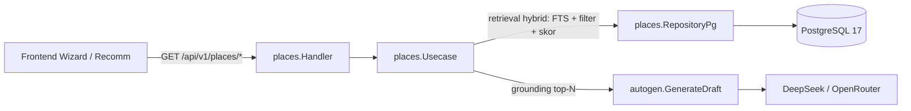

# TRD — Katalog Tempat & Rekomendasi Berbasis RAG

> **Tanggal:** 2026-08-24
> **Status:** Draft TRD
> **Dokumen terkait:** `PLANNING_RAG_REKOMENDASI.md`, `PRD_RAG_REKOMENDASI.md`
> **Pola yang diikuti:** clean architecture backend (`model → usecase → repository → handler`), error `fmt.Errorf("op: %w", err)`, anti-halusinasi AI.

Dokumen ini menjawab 6 pertanyaan wajib yang diajukan & merinci spesifikasi teknis.

---

## 0. Arsitektur target (ringkas)



- Integrasi ke autogen/summary lewat **package `internal/integration`** (pola sudah ada: `TripContextProvider`, `autogen_creator.go`), sehingga domain `places` tidak meng-import domain lain.
- Endpoint rekomendasi bisa dipakai mandiri oleh frontend.

---

## 1. Bagaimana cara mengumpulkan datanya? (Data collection)

> **Perubahan (2026-08-24, sesi kedua):** Google API bermasalah → prioritas dibalik. **Kurasi manual (Mode B) jadi sumber utama** dan tidak butuh `GOOGLE_PLACES_API_KEY`. **Google Places API (Mode A) jadi sekunder/opsional.**

Alur pengumpulan dibagi 2 mode, keduanya via CLI:

### Mode B — Impor seed terkurasi manual (SUMBER UTAMA saat ini)
```
go run ./cmd/place-seed import -file backend/seed/places/bandung.yaml
```
- **Cara ambil datanya (sesekali, manual):** buka Google Maps di browser, cari tempat, lalu salin koordinat:
  - **Klik kanan** pada titik lokasi → panel koordinat muncul → klik angkanya untuk menyalin (format `lat,lng`, mis. `-6.9147,107.6098`).
  - Atau **Bagikan (Share) → Salin link** → URL memuat `@-6.9147,107.6098,17z` (lat, lng, zoom).
- File YAML/JSON berisi baris tempat yang dikurasi manual (termasuk flag `halal_status`, `is_viral`, `tags` yang **tidak bisa ditebak API**).
- Disimpan dengan `source="manual"`, default `coverage_status="unverified"`. Operator menaikkan ke `verified` secara eksplisit — lewat `-coverage verified` saat import (pengecualian yang disengaja bila sengaja dikurasi penuh) atau kueri update setelah ditinjau.
- **Field minimal wajib:** `name`, `city`, `lat`, `lng`, `category`. Sisanya opsional.
- **Dedup**: `ON CONFLICT (lower(name), lower(city))` — idempotent, boleh dijalankan ulang.

### Mode C — Paste link Google Maps (paling cepat; tanpa ketik koordinat)
```
go run ./cmd/place-seed link "https://maps.app.goo.gl/xxx" -category kuliner -halal -viral
go run ./cmd/place-seed link -file links.txt            # 1 link per baris, batch
```
- **Tanpa perlu Google API** — koordinat diekstrak dari URL share:
  - **Full URL** (`...google.com/maps/place/Nama/@-6.9147,107.6098,17z/...`): parse bagian `@lat,lng,zoom` → dapat `lat`,`lng` & slug nama, plus `google_place_id` bila ada.
  - **Short link** (`maps.app.goo.gl/xxx`): 1× redirect (GET) untuk dapat full URL, lalu parse sama.
- Kategori/halal/viral/tags diisi via **flag** atau **prompt interaktif** (lihat Mode D/fitur interaktif).
- Disimpan dengan `source="link"`, `coverage_status="unverified"` (naik ke `verified` setelah Anda yakin).
- Dedup: target utama `(lower(name), lower(city))`; `google_place_id` via pra-cek terpisah (lihat §10).

### Mode D — Eksplorasi dibantu AI (suggest kandidat, tanpa koordinat)
```
go run ./cmd/place-seed suggest -city "Bandung" -theme halal -limit 20
```
- LLM (DeepSeek/OpenRouter yang sudah terpasang) menghasilkan **kandidat** tempat: nama, area, kategori, dugaan halal/viral, deskripsi singkat.
- **PENTING (anti-halusinasi):** AI **tidak boleh** menghasilkan koordinat. Kandidat disimpan `coverage_status="candidate"` **tanpa lat/lng** sampai Anda melengkapinya (via `link`/`import`).
- Alur full: `AI beri kandidat → Anda verifikasi → lengkapi dengan link/koordinat + status → naik ke verified`.
- Pembagian peran: AI untuk *draft* nama/kategori/deskripsi; manusia untuk *fakta* koordinat & status halal/viral.

### Mode A — Fetch otomatis dari Google Places API (SEKUNDER / opsional)
```
go run ./cmd/place-seed fetch -city "Bandung" [-category kuliner] [-halal] [-limit 50]
```
- Hanya diaktifkan bila API pulih / `GOOGLE_PLACES_API_KEY` tersedia.
- Memanggil `Text Search` / `Nearby Search` + `Place Details` untuk nama, lat/lng, kategori/type, rating, foto, `google_place_id`, alamat, jam buka.
- Hasil disimpan dengan `source="google"`, `coverage_status="auto"`.
- **Dedup**: `ON CONFLICT (google_place_id) WHERE google_place_id <> ''` untuk baris ber-`place_id`; sisanya via `(lower(name), lower(city))` (lihat §10).

### Melengkapi field pelengkap (image_url, description, rating, dll.)
Field pelengkap **tidak wajib**; bisa diisi bertahap:
- `image_url` — **metode utama (tanpa key Google, bisa sekarang):** buka tempat di Google Maps → **klik kanan foto** di panel kiri → pilih **"Salin alamat gambar"** (*Copy image address*), atau bawaan DevTools → salin `src` dari ``. Hasilnya URL publik CDN seperti `https://lh3.googleusercontent.com/p/AF1Qip...=w400-h400-k-no`.
  - **Catatan penting:** URL `lh*.googleusercontent.com` ini **sudah bersih & pendek** (~1–2 lines, bukan 2KB) — karena `AF1Qip...` adalah *photo reference* yang tertanam di URL. Jadi **tidak perlu `shortPhotoUrl()`** untuk kasus ini; langsung simpan apa adanya.
  - Foto **tidak ada di dalam share URL** — URL share hanya berisi nama/koordinat/place-id; foto di-load terpisah dari CDN. Maka "Copy image address" adalah cara manual paling praktis untuk Fase eksplorasi.
  - Alternatif: biarkan kosong → fallback placeholder di UI (paling aman bila tak sempat).
- `description`: (a) tulis manual, (b) **draft oleh AI** (subcommand `suggest`/enrich) lalu diedit.
- `rating` / `price_level` / `opening_hours`: dari Google Maps (bintang, `$`, jam buka), dicatat manual, **time-sensitive** → simpan `checked_at`.
- `google_place_id`: otomatis ter-ekstrak di Mode C (`link`).

### Kebijakan (enum `coverage_status` — 4 nilai, SERAGAM)
| Nilai | Berarti | Sumber penulisan | Boleh grounding AI / tampil publik? |
|---|---|---|---|
| `verified` | sudah ditinjau & dikonfirmasi | operator (keputusan final) | ✅ ya |
| `unverified` | data manual, belum ditinjau | `import` / `link` | ⚠️ tampil publik dgn label; ❌ jangan grounding |
| `candidate` | kandidat AI/web-research, tanpa koordinat | `suggest` / web-research | ❌ internal/review saja |
| `auto` | hasil API otomatis, belum ditinjau | `fetch` (Google Places) | ❌ internal/review saja |

- Semua baris berlabel `coverage_status`; hanya `verified` dipakai grounding AI.
- Setiap baris menyimpan `source` (manual, link, suggest, google, osm, ugc) & `source_url`.
- Foto (bila mode A) memakai **helper `shortPhotoUrl()` yang dibuat sebagai task R0** — **jangan simpan URL 2KB `getUrl()`**. Catatan: helper ini **belum ada di kodebase** saat ini; `resolveDestinationMeta.ts` sengaja mengecualikan foto, dan kode yang ada masih memakai `getUrl({ maxWidth: 800 })`. Jadi `shortPhotoUrl()` adalah **pekerjaan baru**, bukan pola eksisting (lihat R0 di §10).

### Default yang longgar (kalau field belum diisi)
CLI `import`/`link`/`suggest` **tidak boleh error** hanya karena field opsional kosong:
- `category` → default `lainnya` (tetap tervalidasi enum).
- `tags` → default array kosong `[]`.
- `halal_status` → default `unknown`.
- `coverage_status` → default mengikuti subcommand: `unverified` (manual: `import`/`link`), `candidate` (`suggest`), `auto` (`fetch`). Naik ke `verified` hanya setelah ditinjau operator.
- `area`, `description`, `image_url`, `source_url` → string kosong.
- Konsekuensi: tempat tanpa kategori/tag tetap tersimpan & bisa direkomendasikan, hanya tidak ter-filter pada query kategori/tag spesifik.

---

## 2. Data dari daerah mana yang mau dikumpulkan? (Scope geografis)

- **Kota pertama (seed acuan): Bandung** — dipakai untuk membangun & menguji tooling serta alur data.
- **Perluasan berikutnya**: 5–10 kota populer (Indonesia: Jakarta, Yogyakarta, Bali/Denpasar, Surabaya; opsional luar: Tokyo, Singapore, KL — menyesuaikan keputusan PRD lanjutan).
- **Granularitas**: `city` + `area` (kecamatan/daerah) + `lat/lng` — memungkinkan "rekomendasi halal dekat area tertentu".
- **Cakupan kategori tiap kota**: kuliner (termasuk halal), wisata alam/budaya, tempat viral/instagramable, masjid/ibadah, belanja/souvenir.
- Penyelesaian lintas kota/negara dihindari: filter `city`/`country_code` di retrieval (menegakkan aturan "jangan tempat dari negara lain").

---

## 3. Mau disimpan dimana? (Storage)

**PostgreSQL 17 (DB utama yang sudah ada)** — tabel `places`.

```sql
-- 021_add_places.sql (Fase 0) — TANPA embedding. Lihat 022 untuk Phase 2.
CREATE TABLE IF NOT EXISTS places (
    id              UUID PRIMARY KEY DEFAULT gen_random_uuid(),
    name            TEXT NOT NULL,
    city            TEXT NOT NULL,
    area            TEXT NOT NULL DEFAULT '',
    country_code    TEXT NOT NULL DEFAULT 'ID',
    lat             DOUBLE PRECISION,              -- nullable: 'candidate'/'auto' boleh tanpa koordinat
    lng             DOUBLE PRECISION,              -- nullable: 'candidate'/'auto' boleh tanpa koordinat
    category        TEXT NOT NULL,                       -- enum 'categories' di bawah
    tags            TEXT[] NOT NULL DEFAULT '{}',
    halal_status    TEXT NOT NULL DEFAULT 'unknown',      -- yes|no|halal_friendly|unknown
    is_viral        BOOLEAN NOT NULL DEFAULT FALSE,
    description     TEXT NOT NULL DEFAULT '',
    image_url       TEXT NOT NULL DEFAULT '',
    google_place_id TEXT NOT NULL DEFAULT '',
    rating          NUMERIC(2,1),
    price_level     TEXT NOT NULL DEFAULT '',
    opening_hours   JSONB,
    coverage_status TEXT NOT NULL DEFAULT 'unverified',  -- verified|unverified|candidate|auto
    source          TEXT NOT NULL DEFAULT '',
    source_url      TEXT NOT NULL DEFAULT '',
    checked_at      TIMESTAMPTZ,
    created_at      TIMESTAMPTZ NOT NULL DEFAULT NOW(),
    updated_at      TIMESTAMPTZ NOT NULL DEFAULT NOW(),
    deleted_at      TIMESTAMPTZ,                   -- NULL = aktif; diisi saat arsip (soft delete)
    CONSTRAINT ck_places_coords CHECK (
        coverage_status IN ('candidate','auto') OR (lat IS NOT NULL AND lng IS NOT NULL)
    )
);

-- Unik utk dedup import
CREATE UNIQUE INDEX IF NOT EXISTS uq_places_google ON places(google_place_id)
    WHERE google_place_id <> '';
CREATE UNIQUE INDEX IF NOT EXISTS uq_places_name_city ON places(lower(name), lower(city));
CREATE INDEX IF NOT EXISTS idx_places_city_category ON places(city, category);
CREATE INDEX IF NOT EXISTS idx_places_halal ON places(halal_status) WHERE halal_status IN ('yes','halal_friendly');
CREATE INDEX IF NOT EXISTS idx_places_viral ON places(is_viral) WHERE is_viral;
CREATE INDEX IF NOT EXISTS idx_places_tags ON places USING GIN(tags);
CREATE INDEX IF NOT EXISTS idx_places_fts ON places USING GIN(
    to_tsvector('simple', name || ' ' || city || ' ' || coalesce(area,'') || ' ' || coalesce(description,''))
);
CREATE INDEX IF NOT EXISTS idx_places_deleted_at ON places(deleted_at) WHERE deleted_at IS NOT NULL;

-- Redis cache utk query populer (bukan bagian migrasi DB).
```

**Migrasi `022_add_places_embedding.sql` (Phase 2, TERPISAH):**
```sql
-- 022_add_places_embedding.sql — HANYA untuk Phase 2 (pgvector).
CREATE EXTENSION IF NOT EXISTS vector;      -- butuh image pgvector/pgvector:pg17 (dev)
ALTER TABLE places ADD COLUMN IF NOT EXISTS embedding vector(1536);  -- dimensi menyesuaikan provider (lihat §7)
CREATE INDEX IF NOT EXISTS idx_places_embedding ON places USING HNSW (embedding vector_cosine_ops);
```

**⚠️ Catatan infra (Phase 2):**
- **Dev (`docker-compose.yml`):** memakai `postgres:17-alpine` yang **tidak menyertakan pgvector**. Saat Phase 2, ganti image ke **`pgvector/pgvector:pg17`** (atau instal `postgresql-17-pgvector`).
- **Prod (`docker-compose.prod.yml`):** **tidak punya service `postgres`** — produksi memakai Postgres terkelola eksternal (Neon). Untuk Phase 2 di prod, pastikan provider tersebut mendukung & mengizinkan `CREATE EXTENSION vector` (Neon sudah mendukung pgvector secara native). Jalankan `CREATE EXTENSION IF NOT EXISTS vector;` sekali di database prod.
- Jangan masukkan ekstensi/kolom `vector` ke migrasi `021`, karena akan gagal di Fase 0. Migrasi `022` selalu memakai `IF NOT EXISTS` agar idempoten (aman dijalankan ulang).

**Catatan storage**:
- **Primary**: PostgreSQL → satu sumber kebenaran, transaksi, sudah terintegrasi pola repo.
- **Cache**: Redis utk respons query populer (pola sudah dipakai utk rate limit/quota).
- **Gambar**: tidak disimpan binary di DB; simpan `image_url` (URL) saja → tampilkan via ``/optimize.
- **Migrasi**: file baru `backend/migrations/021_add_places.sql` (Fase 0) + `022_add_places_embedding.sql` (Phase 2).

---

## 4. Seberapa besar data disimpan? (Volume & growth)

| Tahap | Estimasi baris | Ukuran per baris | Total |
|---|---|---|---|
| Seed MVP (10 kota) | ~500–2.000 tempat | ~1–2 KB + desc/gambar URL | < 5 MB |
| Enrich Google (lanjutan) | ~20–50k | ~1–2 KB | < 100 MB |
| **Batas desain** | **≤ 500k baris** | — | < 1 GB (tanpa embedding) |

- **Dengan embedding** (Phase 2): ukuran baris bergantung dimensi provider embedding. Contoh: 1536-d float4 ≈ 6 KB/baris → 500k baris ≈ **3 GB** utk vektor + index HNSW. Masih layak di satu node PostgreSQL, tapi dimensi harus disepakati dulu (lihat §7).
- PostgreSQL menangani jutaan baris dgn index yg benar; **desain tidak berubah** saat naik dari ribuan ke ratusan ribu.

---

## 5. Apakah data akan berubah? Bagaimana jika berubah? (Data lifecycle)

**Ya — data bersifat time-sensitive.** Kategori perubahan & penanganan:

| Skenario | Sifat | Penanganan |
|---|---|---|
| Resto tutup / pindah | Bersifat permanen | Admin/ingest set `activity` tak ada → archive (`deleted_at`) |
| Harga/rating/peringkat berubah | Volatile | Update field, simpan `checked_at`, tampilkan sebagai info seketika |
| Halal status berubah | Sensitif | Re-verifikasi; `checked_at`; jangan klaim pasti → label "halal_friendly diupdate <tanggal>" |
| Tempat viral baru | Frequent | Ingest `is_viral=true` dari source tren (Google Trends/TikTok/IG); arsip yg tak lagi viral |
| URL gambar rusak | Volatile | Re-fetch / fallback placeholder (catatan: `shortPhotoUrl()` untuk ingest foto Places API Mode A, BUKAN perbaikan URL rusak) |
| Token API Places berubah | Konfig | Pipelines retry & dedup by `google_place_id` |

**Rekomendasi design:**
- **Tabel append/update** (bukan append-only murni): update in-place utk metadata volatile, tapi simpan `checked_at` & `updated_at`.
- **Soft delete** (`deleted_at`) jangan hapus fisik supaya rekomendasi historis & AI grounding tetap konsisten.
- **Idempotent upsert** oleh seeder/pipeline (satu conflict target per statement — lihat §10).
- **Re-ingest berkala** (daily/weekly via CI/cron) utk menyegarkan `is_viral`, `rating`, `checked_at`.

---

## 6. Bagaimana cara verifikasi data? (Verification & trust)

> **Keputusan (2026-08-24):** fase awal pakai **verifikasi dasar saja** (belum pipeline review penuh). Label `coverage_status` tetap dipakai sebagai penanda kepercayaan.

### Verifikasi koordinat (kebal dari halusinasi — faktor terpenting)
- **Aturan arsitektur (sudah ada di autogen)**: *LLM tidak boleh menentukan koordinat*. Koordinat hanya dari:
  1. Kurasi manual dari Google Maps (klik-kanan / link bagikan) — sumber utama saat ini, atau
  2. *(opsional)* Google Places API (`lat/lng` dari place details), atau
  3. (lanjutan) Overpass/OSM.
- Validasi saat masuk DB: `lat`∈[-90,90], `lng`∈[-180,180], dan cek bounding-box kota bila tersedia (tolak "tempat negara lain"). Bila koordinat tampak terbalik (lat/lng tertukar) saat import manual, CLI memberi peringatan.

### Verifikasi halal_status
- Default `unknown`; label "direkomendasikan halal" TANPA klaim pasti; support `halal_friendly`.
- Data dari Google API umumnya **tidak** memberi status halal → diisi via kurasi manual/import (Mode B) atau ditandai `unknown`.

### Validasi programatik (di CLI, sebelum masuk DB)
- `name`/`city` tidak kosong.
- Enum `category`, `halal_status`, `coverage_status` valid.
- `image_url` format URL valid & panjang terbatas.
- Dedup by `google_place_id` / `(name, city)`.

### Tahap lanjutan (bukan fase tooling awal)
- Pipeline 3-stage (`ingest → validation → review → verified`) untuk kurasi massal.
- Verifikasi post-LLM di integration saat fitur grounding AI aktif: tiap aktivitas `location` hasil generate harus cocok kota destinasi dan memakai koordinat corpus (bukan koordinat LLM).

---

## 7. Spesifikasi backend (mapping ke kode)

### Struktur folder
```
backend/
├── cmd/place-seed/                          # CLI tooling data (Fase 0, dikerjakan duluan)
│   ├── main.go                              # subcommands: import | link | suggest | fetch (ops) | status
│   └── (import YAML, paste link Maps, AI suggest, fetch Google Places opsional, validasi dasar)
├── seed/places/                             # file seed kurasi manual (sumber utama saat ini)
│   └── bandung.yaml
├── internal/places/
│   ├── model.go                             # Place struct + enum
│   ├── repository.go                        # interface
│   ├── repository_pg.go                     # pgx impl (Upsert, List, GetByIDs)
│   ├── usecase.go                           # (fase fitur) Recommend, Search
│   └── handler.go                           # (fase fitur) routes + binding
├── pkg/gplaces/                             # (opsional) klien Google Places API untuk subcommand fetch
├── pkg/gmaplink/                            # parser URL Google Maps (ekstrak lat/lng/nama/place_id tanpa API)
├── internal/integration/places_grounding.go # (fase fitur) adapter ke autogen/summary
├── migrations/021_add_places.sql
├── migrations/022_add_places_embedding.sql  # Phase 2 (pgvector, TERPISAH)
```

### Fase 0 — Tooling pengisian data (dikerjakan lebih dulu)

**CLI `cmd/place-seed`** dengan 5 subcommand:

| Subcommand | Fungsi | Contoh |
|---|---|---|
| `import` | **Jalur utama.** Impor seed YAML/JSON (kurasi manual; bisa set `halal_status`/`is_viral`/`tags`) | `go run ./cmd/place-seed import -file seed/places/bandung.yaml` |
| `link` | **Paste link Google Maps** → ekstrak `lat/lng`/nama/`place_id` tanpa API; isi kategori/halal via flag atau prompt | `go run ./cmd/place-seed link "https://maps.app.goo.gl/xxx" -halal` |
| `suggest` | **AI bantu eksplorasi** — hasilkan kandidat nama/kategori/deskripsi (tanpa koordinat, `coverage=candidate`) | `go run ./cmd/place-seed suggest -city Bandung -theme halal -limit 20` |
| `fetch` | *(opsional)* Ambil tempat dari **Google Places API** by kota/kategori (butuh key) | `go run ./cmd/place-seed fetch -city Bandung -category kuliner -halal -limit 50` |
| `status` | Tampilkan jumlah tempat per kota/kategori/coverage | `go run ./cmd/place-seed status -city Bandung` |

**Flag utama `import`:** `-file` (wajib), `-dry-run` (tampilkan tanpa tulis DB), `-coverage` (override: `verified`/`unverified`/`candidate`/`auto`, default ikut file atau `unverified`).

**Flag utama `link`:** argumen link (atau `-file` untuk batch, 1 link/baris), `-category`, `-halal`, `-viral`, `-tags` (koma), `-interactive` (prompt per baris bila flag tidak diberikan).

**Flag utama `suggest`:** `-city` (wajib), `-theme` (halal|viral|kuliner|wisata|budaya|dsb.), `-limit` (default 20), `-dry-run`. Output berupa daftar kandidat + `--save` untuk tulis ke DB `coverage=candidate` tanpa koordinat.

**`pkg/gmaplink`** mem-parse URL Google Maps tanpa API:
- Full URL (`.../maps/place/Nama/@lat,lng,zoom/...`) → ekstrak `lat`, `lng`, slug nama, `place_id` (bila ada).
- Short link (`maps.app.goo.gl/xxx`) → 1× GET redirect → parse full URL. **Catatan realistis:** short link sering butuh header `User-Agent` browser agar redirect berhasil; dan koordinat kadang berbentuk parameter `!3d<lat>!4d<lng>`, bukan `@lat,lng`. Implementasikan **kedua fallback** ini di parser.

**`pkg/gplaces`** membungkus endpoint resmi (hanya dipakai subcommand `fetch`):
- `POST https://places.googleapis.com/v1/places:searchText` (Text Search / Search Nearby)
- `GET https://places.googleapis.com/v1/places/{place_id}` (Place Details)
- Peta respons ke `places.Place`; foto (bila diambil) lewat helper `shortPhotoUrl()` yang dibuat di R0.

**Ketergantungan:**
- `import`, `link`, `status`: **tidak butuh key** apa pun — hanya `DATABASE_URL`. Inilah yang membuat fase tooling bisa langsung dikerjakan sekarang.
- `suggest`: butuh key LLM (sudah ada: DeepSeek/OpenRouter).
- `fetch`: butuh `GOOGLE_PLACES_API_KEY` (server-side, di `.env`/config), ditambahkan ke `config.GoogleConfig.PlacesAPIKey` saat build.
- **⚠️ CLI `place-seed` JANGAN memakai `config.Load()`.** `config.Load()` + `Validate()` **mewajibkan** `JWT_SECRET`/`JWT_REFRESH_SECRET` bahkan di dev — CLI akan gagal start. `place-seed` membaca `DATABASE_URL` langsung dari env (atau `.env` via `godotenv`), tanpa melewati `config.Load()`.

**Output ke DB:** `repository_pg.Upsert` idempotent. **Satu `INSERT ... ON CONFLICT` hanya menerima SATU conflict target** — jangan anggap dua unique index bisa ditarget sekaligus:
1. Target utama: `ON CONFLICT (lower(name), lower(city)) DO UPDATE SET ...`.
2. Bila `google_place_id` terisi: pra-cek (`SELECT id FROM places WHERE google_place_id=$1`) ATAU upsert kedua `ON CONFLICT (google_place_id) WHERE google_place_id <> ''` — karena `uq_places_google` adalah **partial index**, inferensi konfliknya harus menyertakan predikat `WHERE google_place_id <> ''`.

### Package `internal/places`

**Konstanta & enum terpusat (definisikan DI SATU TEMPAT, di `model.go`)** — dipakai oleh validasi, repository, dan seed agar sinkron:

```go
const (
    // category — WAJIB menyertakan "lainnya" (konsisten dengan default longgar)
    CategoryKuliner    = "kuliner"
    CategoryWisataAlam = "wisata_alam"
    CategoryBudaya     = "budaya"
    CategoryBelanja    = "belanja"
    CategoryIbadah     = "ibadah"
    CategoryAkomodasi  = "akomodasi"
    CategoryLainnya    = "lainnya"   // default saat belum dipilih
)

var validCategories = [...]string{...} // sumber kebenaran validasi + seed

// halal_status: yes | no | halal_friendly | unknown
// coverage_status: verified | unverified | candidate | auto
```

> `candidate` = kandidat dari `suggest`/web-research (tanpa koordinat, internal/review). Nilai final yang SERAGAM di seluruh dokumen: **`verified | unverified | candidate | auto`** — dipakai validasi, repository, dan CLI.

**Konfigurasi tambahan (item kerja):**
- `config.GoogleConfig` saat ini hanya berisi `ClientID/ClientSecret/RedirectURL`. Saat Mode A (`fetch`) aktif, tambahkan field `PlacesAPIKey` (`mapstructure:"places_api_key"`) + bind env `GOOGLE_PLACES_API_KEY` di `config.Load()` + entri `.env.example`. Ini item kecil yang **belum ada** — jangan lupa saat mengaktifkan `fetch`.
- **Dimensi embedding (Phase 2):** jangan hardcode. Tetapkan provider + dimensi saat masuk Phase 2, mis. `text-embedding-3-small` = 1536, atau model lain menyesuaikan. Tulis dimensi di satu tempat (`022`) dan samakan dengan `pkg/embed`.

**`repository.go` — interface**
```go
type Repository interface {
    Search(ctx context.Context, q SearchQuery) ([]Place, error)      // hybrid retrieval
    GetByIDs(ctx context.Context, ids []string) ([]Place, error)     // utk grounding
    GetVerifiedByNames(ctx context.Context, city string, names []string) ([]Place, error) // pencocokan nama batch pasca-LLM (hanya coverage_status='verified')
    Upsert(ctx context.Context, p Place) error                       // admin/seeder
}
```

> **Pencocokan nama pasca-LLM butuh metode batch eksplisit** (`GetVerifiedByNames`), bukan `Search` FTS per-nama: lebih bersih & mudah di-test. `GetByIDs`/`GetVerifiedByNames` hanya mengembalikan `coverage_status='verified'` untuk grounding/supply koordinat.

> **⚠️ Semua query baca (`Search`/`GetByIDs`/`GetVerifiedByNames`) WAJIB menyaring `WHERE deleted_at IS NULL`**. Tanpa ini, tempat yang sudah diarsip (soft-delete) akan tetap muncul di rekomendasi/search/grounding.

**`usecase.go` — ke arah anti-halusinasi**
```go
type RecommendInput struct {
    City       string   // optional, filter
    Area       string
    Category   string
    Halal      bool     // if true: halal_status in (yes, halal_friendly)
    Viral      bool
    Style      string   // backpacker=kuliner murah; luxury, dll → maps to filter/tag
    Limit      int
}
type RecommendOutput struct {
    Places []ScoredPlace `json:"places"`
}
// ScoredPlace menebalkan: place + Score + Reason (kata singkat kenapa cocok)
```

**`usecase.go` — retrieval (Fase 1: FTS + filter + skor)**
```
query dibangun dinamis dr filter opsional
-- SEMUA query membaca tempat AKTIF saja: WHERE deleted_at IS NULL
-- FTS memakai ekspresi PERSIS SAMA dgn GIN index agar index terpakai:
--   to_tsvector('simple', name || ' ' || city || ' ' || coalesce(area,'') || ' ' || coalesce(description,''))
skor = weight_fts * ts_rank(tsvector(name|city|desc), query)
     + weight_halal * (halal yes) + weight_viral * is_viral
     + weight_category * match(category) + weight_style[] (tag)
order: skor desc
limit: N
```

**`handler.go` — routes**
```go
func (h *Handler) RegisterRoutes(g *echo.Group, auth echo.MiddlewareFunc) {
    g.GET("/places/search",     h.Search, auth)
    g.GET("/places/recommend",  h.Recommend, auth)
}
```

**Error handling**: `fmt.Errorf("places.<op>: %w", err)`; unknown category → `apperr`.

### Integrasi grounding (autogen)

> **PENTING — pola injeksi yang benar (bukan memanggil `BuildPrompt`).** `BuildPrompt` adalah fungsi murni `func BuildPrompt(in GenerateInput) (system, user string)` — ia **tidak bisa** memanggil adapter. Preseden yang tepat sudah ada: `DayContextProvider` + `WithDayContextProvider()` pada `autogen.Usecase` (dipakai `GenerateDayPreview`). Grounding mengikuti pola yang sama.

Pada `integration/places_grounding.go` + perubahan kecil di `autogen`:

1. **Provider baru di `autogen`:** interface `PlaceContextProvider{ GetPlaces(ctx, destination, style) ([]PlaceContext, error) }` + `WithPlaceContextProvider(p) *Usecase`, dengan `PlaceContext = {name, city, category, halal, lat, lng, description}`. Dipanggil di `GenerateDraft` **sebelum** `BuildPrompt` (atau `GenerateInput` diperluas field grounding).
2. **Prompt grounding (nama saja, TANPA koordinat):** block system prompt:
   ```
   ## TEMPAT NYATA (WAJIB DIPAKAI utk aktivitas location)
   - Nama Tempat | Kota | Kategori | Halal | Deskripsi singkat
   ```
   LLM hanya memilih **nama tempat nyata**; `ParseAndValidate` tetap men-strip `lat/lng` (anti-halusinasi, tidak berubah).
3. **Pasang koordinat SETELAH `GenerateDraft` kembali (di luar autogen):** layer `integration` mencocokkan `LocationName` aktivitas `location` dengan corpus (normalisasi nama) → isi `ActivityDraft.Lat/Lng/GooglePlaceID` + `LocationVerification="verified"`. Autogen **tidak tahu** soal corpus.
   - **⚠️ Pencocokan nama bersifat fuzzy & rawan salah.** LLM bisa menulis ulang nama ("Braga Permai" vs "Restoran Braga Permai"). Pakai normalisasi (casefold, hapus tanda baca, tokenisasi) + ambang kemiripan; **kalau di bawah ambang → JANGAN paksa koordinat** — biarkan `LocationVerification=""`/`"needs_review"` dan resolver frontend berjalan seperti biasa. Anti-halusinasi terjaga di titik paling sensitif ini (koordinat hanya ditempel bila nama *betul-betul* cocok).
4. **Frontend resolver sudah menangani skip (bukan pekerjaan baru):** `resolveDraftLocations.ts:68-69` sudah punya `if (act.lat != null && act.lng != null) continue` — aktivitas berkoordinat langsung dilewati sebelum `markNeedsReview`. Karena baris `verified` corpus dijamin berkoordinat (CHECK constraint), mekanisme existing sudah cukup. R4 cukup **memverifikasi** perilaku ini, bukan menambah cabang baru.
5. **Mapping kategori:** enum `places` memakai `wisata_alam`/`ibadah`/`lainnya` (snake_case), sedangkan prompt autogen memvalidasi `"wisata alam"` (spasi) dan **tidak punya** `ibadah`/`lainnya`. Saat grounding/pasang-koordinat, petakan `wisata_alam → "wisata alam"`; `ibadah`/`lainnya` → fallback `"kuliner"` (sesuai `sanitizeCategory`) ATAU perluas `validCategories` autogen.
6. **Cakupan `GenerateDayPreview` (diputuskan):** grounding juga berlaku di day-preview — pola `DayContextProvider` sudah ada; retrieval tempat dekat koordinat hari itu → suntik nama → pasang koordinat pasca-LLM. Bila ingin menunda, tulis eksplisit "day-preview grounding ditunda".
7. **Wiring (decorator di `main.go`):** `autogen/handler.go` memanggil `h.usecase.GenerateDraft` langsung. Agar enrichment pasca-LLM terjadi di luar autogen, `integration` membungkus `autogen.UsecaseInterface` sebagai **decorator** yang di-wire di `main.go` (pola sama dengan `TripCreator`/`AutogenCreator`): decorator memanggil `GenerateDraft` inner, lalu melakukan pemasangan koordinat (`GetVerifiedByNames` + fuzzy match) sebelum mengembalikan draft.

### Cache Redis (opsional, pola sudah ada)
- `key: places:recommend:{city}:{category}:{halal}:{viral}` TTL 5–15 mnt; fallback ke DB.

---

## 8. Spesifikasi frontend (ringkas)

- Feature slice baru `src/features/places/`:
  - `api.ts` (typed via `lib/api.ts`), `types.ts`
  - `components/PlaceRecommendationCard.tsx` (gambar, badge halal/viral, kategori)
  - `hooks/usePlaceRecommendations.ts` (**TanStack Query**; `staleTime: 5*60*1000` eksplisit; pakai `mutate`+callback utk mutasi, **bukan** `mutateAsync`)
- Integrasi ke `DestinationAutocomplete` (badge/kanal rekomendasi di samping field) & `GenerateChatWizard`.
- Pemilihan tempat → jadi aktivitas tempat; **gambar (bila ada) lewat helper `shortPhotoUrl()` yang dibuat di R0** (jangan simpan URL panjang `getUrl()`).

---

## 9. Definisi selesai / acceptance criteria

### Fase 0 (tooling data) — target saat ini
- [ ] Migrasi `021_add_places.sql` ada & jalan.
- [ ] `cmd/place-seed import` membaca `seed/places/bandung.yaml` & menyimpan baris (termasuk `halal_status`/`is_viral`/`tags`) ke DB — **tanpa perlu key Google**.
- [ ] `cmd/place-seed status` menampilkan ringkasan per kota/kategori/coverage.
- [ ] `cmd/place-seed fetch` *(opsional, bersyarat key)* mengambil tempat dari Google Places API & menyimpan (dedup idempotent).
- [ ] Validasi dasar (lat/lng rentang, enum, dedup, peringatan lat/lng tertukar) mencegah data kotor; `go test ./...` hijau.

### Fase fitur (setelah tooling)
- [ ] `GET /places/recommend` & `/search` mengembalikan data terfilter & terurut, di bawah 200ms — **dan hanya baris aktif (`deleted_at IS NULL`)**.
- [ ] Hanya `verified` yang masuk ke grounding AI; `candidate`/`auto`/`unverified` tidak pernah jadi koordinat.
- [ ] Generate trip: aktivitas `location` utk tempat bernama sama dgn corpus memakai koordinat corpus; tidak muncul tempat di luar kota. Nama tak cocok di bawah ambang → koordinat **tidak** dipaksa (resolver frontend ambil alih).
- [ ] Frontend menampilkan kartu rekomendasi & mengonversi pilihan menjadi aktivitas.
- [ ] Unit test `places/usecase_test.go` (retrieval, filter, skor) + integrasi grounding; `go test ./...` hijau.

---

## 10. Urutan implementasi (rings)

| Ring | Scope | Estimasi |
|---|---|---|
| **R0 — Tooling data** *(dikerjakan duluan)* | `migrations/021_add_places.sql` + `internal/places/model+repo` + `cmd/place-seed` (`import` utama / `fetch` opsional / `status`) + `seed/places/bandung.yaml`. **Termasuk membuat helper `shortPhotoUrl()`** (belum ada) di `pkg/gplaces`. `pkg/gplaces` boleh ditunda. | 3–4 hari |
| **R1** | Validasi dasar + dedup idempotent + test repo/usecase | 1–2 hari |
| **R2** | `internal/places` usecase+handler (search/recommend) + unit test | 2–3 hari |
| **R3** | grounding `integration/places_grounding.go` + `PlaceContextProvider` di `autogen` + pasang koordinat pasca-LLM (`LocationVerification`) + mapping kategori + post-validasi kota | 2–3 hari |
| **R4** | Frontend `features/places` + integrasi wizard | 2–3 hari |
| **R5** (Phase 2) | `migrations/022_add_places_embedding.sql` + ganti image Postgres ke `pgvector/pgvector:pg17` + `pkg/embed` + hybrid rerank | 3–5 hari |

> Catatan: R0 **bisa dimulai sekarang** karena subcommand `import`/`status` tidak membutuhkan key Google apa pun. `pkg/gplaces` + subcommand `fetch` ditunda sampai API pulih/key tersedia.

### ⚠️ Catatan dedup (`ON CONFLICT` ekspresi index)
`ON CONFLICT (lower(name), lower(city))` hanya valid bila **unique index** didefinisikan dengan ekspresi yang **persis sama**:
```sql
CREATE UNIQUE INDEX uq_places_name_city ON places (lower(name), lower(city));
```
Spesifikasi konflik harus **match string persis** dengan index-nya, mis. `ON CONFLICT (lower(name), lower(city)) DO UPDATE SET ...`. Kalau tidak match, Postgres akan memberi error `invalid ON CONFLICT specification`. Jangan tulis `ON CONFLICT (name, city)` (tanpa `lower()`) karena index-nya memakai `lower()`.

**Dua index unik tidak bisa ditarget sekaligus dalam satu statement** (`INSERT ... ON CONFLICT` hanya menerima **satu** conflict target). Strategi eksplisit:
1. Target utama: `ON CONFLICT (lower(name), lower(city)) DO UPDATE SET ...`.
2. Khusus `google_place_id` (partial unique index `uq_places_google WHERE google_place_id <> ''`): lakukan **pra-cek** `SELECT ... WHERE google_place_id=$1` sebelum insert, ATAU upsert terpisah `ON CONFLICT (google_place_id) WHERE google_place_id <> '' DO UPDATE ...` — karena index-nya partial, inferensi konflik **wajib menyertakan predikat** `WHERE google_place_id <> ''`.