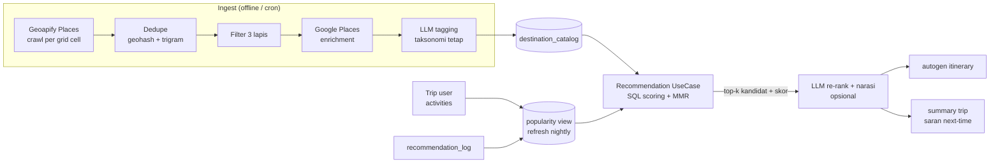

# TRD — Katalog Destinasi & Mesin Rekomendasi

| | |
|---|---|
| **Fitur** | Destination Catalog & Recommendation Engine |
| **PRD** | `PRD_DESTINATION_RECOMMENDATION.md` |
| **Status** | Draft |
| **Tanggal** | 2026-08-31 |

Dokumen ini menerjemahkan PRD menjadi rancangan teknis: skema DB, struktur modul Go, API, pipeline crawler, dan integrasi dengan `autogen`/`summary`.

---

## 1. Arsitektur Overview



Modul baru di backend: `internal/destination/` (katalog + rekomendasi), plus `cmd/crawl-destinations/` untuk job ingest.

## 2. Skema Database

Migration baru: `021_add_destination_catalog.sql`.

```sql
-- ── Katalog destinasi ──
CREATE TABLE IF NOT EXISTS destination_catalog (
    id               UUID PRIMARY KEY DEFAULT gen_random_uuid(),
    city             TEXT NOT NULL,                    -- 'bandung'
    area             TEXT NOT NULL DEFAULT '',         -- 'lembang', 'dago', ...
    geohash          TEXT NOT NULL DEFAULT '',         -- presisi 6, utk clustering
    name             TEXT NOT NULL,
    aliases          TEXT[] NOT NULL DEFAULT '{}',
    description      TEXT NOT NULL DEFAULT '',
    latitude         DOUBLE PRECISION NOT NULL,
    longitude        DOUBLE PRECISION NOT NULL,
    category         TEXT NOT NULL,                    -- wisata|kuliner|cafe|belanja|alam|budaya
    sub_type         TEXT NOT NULL DEFAULT '',         -- theme-park, museum, ...
    tags             TEXT[] NOT NULL DEFAULT '{}',     -- taksonomi tetap
    price_tier       SMALLINT,                         -- 1..3, NULL = unknown
    rating           NUMERIC(3,2),                     -- dari Google Places
    rating_count     INT NOT NULL DEFAULT 0,
    rating_prev      INT NOT NULL DEFAULT 0,           -- rating_count periode lalu (velocity)
    typical_duration_min INT NOT NULL DEFAULT 120,
    status           TEXT NOT NULL DEFAULT 'active'
                     CHECK (status IN ('active','user-submitted','inactive')),
    -- Provenance
    provider         TEXT NOT NULL DEFAULT 'geoapify', -- geoapify|google|osm|user
    external_id      TEXT NOT NULL DEFAULT '',         -- place_id provider
    source_url       TEXT NOT NULL DEFAULT '',
    is_hidden_gem    BOOLEAN NOT NULL DEFAULT FALSE,
    created_at       TIMESTAMPTZ NOT NULL DEFAULT NOW(),
    updated_at       TIMESTAMPTZ NOT NULL DEFAULT NOW(),
    signals_updated_at TIMESTAMPTZ                     -- kapan rating/count terakhir di-refresh
);

-- Dedupe & lookup
CREATE UNIQUE INDEX IF NOT EXISTS uq_dest_provider_ext
    ON destination_catalog (provider, external_id)
    WHERE external_id <> '';
CREATE INDEX IF NOT EXISTS idx_dest_city_cat   ON destination_catalog (city, category) WHERE status <> 'inactive';
CREATE INDEX IF NOT EXISTS idx_dest_geohash    ON destination_catalog (geohash);
CREATE INDEX IF NOT EXISTS idx_dest_tags_gin   ON destination_catalog USING GIN (tags);
CREATE INDEX IF NOT EXISTS idx_dest_name_trgm  ON destination_catalog USING GIN (name gin_trgm_ops); -- butuh pg_trgm

-- ── Synonym untuk text search (tanpa stemmer ID) ──
CREATE TABLE IF NOT EXISTS destination_synonyms (
    id        UUID PRIMARY KEY DEFAULT gen_random_uuid(),
    canonical TEXT NOT NULL,        -- 'kafe'
    variant   TEXT NOT NULL,        -- 'coffee shop', 'kedai kopi'
    UNIQUE (canonical, variant)
);

-- ── Feedback loop ──
CREATE TABLE IF NOT EXISTS recommendation_log (
    id          BIGSERIAL PRIMARY KEY,
    trip_id     UUID NOT NULL REFERENCES trips(id) ON DELETE CASCADE,
    catalog_id  UUID NOT NULL REFERENCES destination_catalog(id) ON DELETE CASCADE,
    context     TEXT NOT NULL,      -- 'autogen' | 'summary' | 'add-activity'
    position    INT NOT NULL,       -- urutan tampil
    accepted    BOOLEAN,            -- NULL = belum direspons
    created_at  TIMESTAMPTZ NOT NULL DEFAULT NOW()
);
CREATE INDEX IF NOT EXISTS idx_reclog_catalog ON recommendation_log (catalog_id, created_at);

-- ── Popularitas dari perilaku user (materialized view, refresh nightly) ──
CREATE MATERIALIZED VIEW IF NOT EXISTS destination_popularity AS
SELECT
    dc.id AS catalog_id,
    COUNT(DISTINCT a.id) FILTER (WHERE a.catalog_id IS NOT NULL) AS used_count,
    COALESCE(SUM(CASE WHEN rl.accepted THEN 1 ELSE 0 END), 0) AS accepted_count,
    COALESCE(SUM(CASE WHEN rl.accepted IS NOT NULL THEN 1 ELSE 0 END), 0) AS shown_count
FROM destination_catalog dc
LEFT JOIN activities a ON a.catalog_id = dc.id
LEFT JOIN recommendation_log rl ON rl.catalog_id = dc.id
GROUP BY dc.id;
CREATE UNIQUE INDEX IF NOT EXISTS uq_destpop_catalog ON destination_popularity (catalog_id);
```

Perubahan pada tabel yang ada — `022_link_activities_to_catalog.sql`:

```sql
-- Link activity user ke katalog (ground truth + ko-okurensi)
ALTER TABLE activities ADD COLUMN IF NOT EXISTS catalog_id UUID
    REFERENCES destination_catalog(id) ON DELETE SET NULL;
CREATE INDEX IF NOT EXISTS idx_activities_catalog ON activities (catalog_id) WHERE catalog_id IS NOT NULL;

-- pg_trgm untuk fuzzy name matching
CREATE EXTENSION IF NOT EXISTS pg_trgm;
```

> **Catatan**: `activities.payload` JSONB tetap dipakai untuk data location bebas; `catalog_id` nullable agar activity lama/manual tidak rusak.

## 3. Struktur Modul Go

Mengikuti pola existing (`internal/summary`, `internal/location`):

```
backend/internal/destination/
    model.go           # Destination, Recommendation, RecommendInput structs
    repository.go      # interface Repository
    repository_pg.go   # implementasi pgxpool (pola summary/repository_pg.go)
    scoring.go         # pure functions: BayesianRating, Jaccard, Haversine, MMR
    scoring_test.go
    usecase.go         # Recommend(ctx, input) ([]Recommendation, error)
    usecase_test.go
    handler.go         # HTTP handler echo + RegisterRoutes
    handler_test.go

backend/cmd/crawl-destinations/
    main.go            # CLI: --city bandung --phase crawl|enrich|tag|refresh

backend/internal/destination/ingest/
    geoapify_places.go # client /v1/places/search (reuse pola location/client.go)
    google_places.go   # client Place Details (enrichment)
    dedupe.go          # geohash neighbor + trigram similarity
    filter.go          # white-list kategori + threshold per kategori
    tagger.go          # LLM batch tagging via pkg/llm
```

### 3.1 Scoring (pure Go, teruji unit)

```go
// Bayesian average: C = prior weight (mis. 50), m = mean rating global kota
func BayesianRating(rating float64, count int, C float64, globalMean float64) float64

// Jaccard similarity dua himpunan tags
func Jaccard(a, b []string) float64

// Haversine km
func HaversineKm(lat1, lng1, lat2, lng2 float64) float64

// Review velocity dari rating_count sekarang vs periode lalu
func ReviewVelocity(current, prev int, ageMonths int) float64

// MMR: pilih k item yang balance antara skor dan diversitas kategori/sub_type
func MMR(candidates []Scored, k int, lambda float64) []Scored
```

Skor akhir (bobot awal, bisa di-tune via `app_settings`):

```
score = 0.30·bayesianRating + 0.25·popularity + 0.20·tagSim
      + 0.15·budgetFit + 0.10·proximity
```

`popularity` = normalisasi gabungan `used_count` (user ground truth, bobot lebih besar) + recency-weighted `rating_count` delta. `proximity` = `1 / (1 + km/5)`.

### 3.2 Query rekomendasi inti (Postgres)

Prefilter + kandidat di SQL, scoring akhir + MMR di Go:

```sql
SELECT id, name, category, sub_type, tags, rating, rating_count,
       price_tier, latitude, longitude, description,
       (rating_count - rating_prev) AS review_delta
FROM destination_catalog
WHERE city = $1
  AND status <> 'inactive'
  AND category = ANY($2)                       -- filter kategori
  AND ($3::SMALLINT IS NULL OR price_tier IS NULL OR price_tier <= $3)
  AND (rating IS NULL OR rating >= $4)
  AND tags && $5::TEXT[]                       -- overlap tags (Jaccard dihitung di Go)
ORDER BY rating_count DESC
LIMIT 50;
```

Text search (fase M5, Opsi C PRD):

```sql
-- Fuzzy name match via pg_trgm
SELECT * FROM destination_catalog
WHERE city = $1 AND name % $2                  -- similarity operator
ORDER BY similarity(name, $2) DESC LIMIT 10;
```

## 4. API

Semua endpoint di bawah group auth (pola `location.Handler.RegisterRoutes`).

### 4.1 `GET /destinations/recommendations`

Query params: `city` (wajib), `categories`, `tags`, `budget_tier`, `near_lat`, `near_lng`, `exclude_ids`, `limit` (default 5, max 20).

```json
{
  "recommendations": [
    {
      "id": "uuid",
      "name": "Kawah Putih",
      "category": "alam",
      "tags": ["outdoor", "instagramable"],
      "rating": 4.6,
      "rating_count": 12400,
      "price_tier": 1,
      "lat": -7.023, "lng": 107.418,
      "score": 0.87,
      "reason": "rating tinggi & sering dikunjungi user lain di trip Bandung"
    }
  ]
}
```

Side effect: setiap pemanggilan menulis baris ke `recommendation_log` (context dari header/param).

### 4.2 `POST /destinations/feedback`

```json
{ "trip_id": "uuid", "catalog_id": "uuid", "accepted": true }
```

### 4.3 `GET /destinations/search?city=bandung&q=kafe vintage`

Fase M5 — gabungan `pg_trgm` + synonym expansion + filter terstruktur.

### 4.4 Integrasi existing

- **autogen** (`internal/autogen/usecase.go`): sebelum panggil LLM, panggil `destination.Recommend` per kategori untuk kota tujuan → kandidat + skor ditempel ke prompt (`autogen/prompt.go`). LLM memilih & menarasikan; output tetap divalidasi `validate.go`.
- **summary** (`internal/summary/usecase.go`): setelah summary dibuat, ambil tags/kategori dari `TripContext.Days[].Activities`, panggil `Recommend` dengan `exclude_ids` = tempat yang sudah dikunjungi → lampirkan 2–3 saran "next time" di akhir summary. Menggantikan pelengkap `localTips` yang generik dengan saran yang grounded.

## 5. Pipeline Crawler (`cmd/crawl-destinations`)

Fase-fase idempotent (bisa diulang per fase):

| Fase | Kerja | Output |
|---|---|---|
| `crawl` | Geoapify `/v1/places/search` per geohash-6 cell × kategori white-list; rate limit 5 req/s; cache hasil per cell di file `tmp/crawl-{city}/` | baris `status='active'` mentah |
| `dedupe` | Union antar cell; jarak < 150 m + trigram name sim > 0.6 → merge (pertahankan yang rating_count terbesar) | katalog tanpa duplikat |
| `filter` | Threshold per kategori (konfigurasi di `filter.go`); hidden-gem flag | subset layak |
| `enrich` | Google Place Details per `external_id` → rating, count, price_level; UPSERT kolom sinyal + `signals_updated_at` | sinyal segar |
| `tag` | LLM batch (via `pkg/llm`): input nama+kategori+deskripsi → tags dari taksonomi tetap; prompt memaksa JSON array | `tags[]` terisi |
| `refresh` | Bulanan: hanya fase `enrich` untuk ID existing + simpan `rating_prev` sebelum update | velocity bisa dihitung |

Konfigurasi kota (grid bounds, area penyangga, seed queries) di file YAML: `backend/config/destinations/bandung.yaml`.

Job periodik (cron di deployment):

- **Nightly**: `REFRESH MATERIALIZED VIEW destination_popularity CONCURRENTLY;`
- **Bulanan**: `crawl-destinations --city X --phase refresh`
- **Kuartalan**: re-crawl struktur penuh per kota

## 6. Self-Healing (User-Submitted)

Saat activity location disimpan (`internal/activity`): coba match ke katalog via nama trigram + radius 150 m.

- Match → set `activities.catalog_id`.
- Tidak match → insert `destination_catalog(status='user-submitted', provider='user', rating=NULL)` dan enqueue enrich di job berikutnya. Entri `user-submitted` boleh direkomendasikan hanya setelah di-enrich dan rating ≥ threshold.

## 7. Konfigurasi

Tambahan di `config.yaml` (pola section `location:` yang ada):

```yaml
destination:
  enabled: true
  google_places_base_url: https://maps.googleapis.com/maps/api/place
  crawl_rate_limit_rps: 5
  score_weights:            # bisa di-override via app_settings
    rating: 0.30
    popularity: 0.25
    tag_sim: 0.20
    budget_fit: 0.15
    proximity: 0.10
  bayesian_prior: 50
```

API key Google Places dibaca dari env (`GOOGLE_PLACES_API_KEY`) — jangan masuk config.yaml.

## 8. Testing Strategy

| Lapis | Alat | Cakupan |
|---|---|---|
| Scoring functions | `go test` unit | Bayesian, Jaccard, Haversine, MMR deterministik |
| Repository | integration test pgx (pola `tests/integration`) | CRUD katalog, query filter, log |
| Handler | httptest + echo | validasi param, kontrak JSON |
| Crawler | dry-run mode (`--dry-run`, tanpa write DB) + snapshot CSV | review manual kualitas hasil Bandung |
| Usecase | mock repository | komposisi skor, MMR, exclude_ids |

## 9. Urutan Implementasi (selaras milestone PRD)

1. **M1**: migration 021–022 → `cmd/crawl-destinations` (crawl→dedupe→filter) → dry-run Bandung → review CSV.
2. **M2**: `internal/destination` (model, repo, scoring, usecase, handler) + endpoint 4.1–4.2.
3. **M3**: wiring autogen + summary (bagian 4.4).
4. **M4**: `recommendation_log` write path, popularity view + nightly refresh, self-healing (§6), job `refresh` bulanan.
5. **M5**: endpoint search 4.3, synonym table, ekspansi kota kedua (konfigurasi YAML baru, tanpa kode baru).

## 10. Keputusan Desain & Alternatif yang Ditolak

| Keputusan | Alasan |
|---|---|
| Postgres-only (tanpa vector store) | Skala ribuan POI per kota; BM25-like `tsvector` + `pg_trgm` + Jaccard cukup; menghindari infra & re-embedding |
| Skor dihitung saat query, tidak disimpan | Update sinyal tidak pernah butuh re-index; selalu segar |
| Jam buka tidak disimpan | Cepat basi; ambil on-demand + cache 1 hari |
| LLM hanya re-ranker/narator | Grounding deterministik dulu → murah, bisa dijelaskan, anti-halusinasi |
| Threshold kualitas per kategori | Ambang global membuang museum kecil / hidden gem |
| `catalog_id` nullable di activities | Backward-compatible dengan data lama & activity manual |
